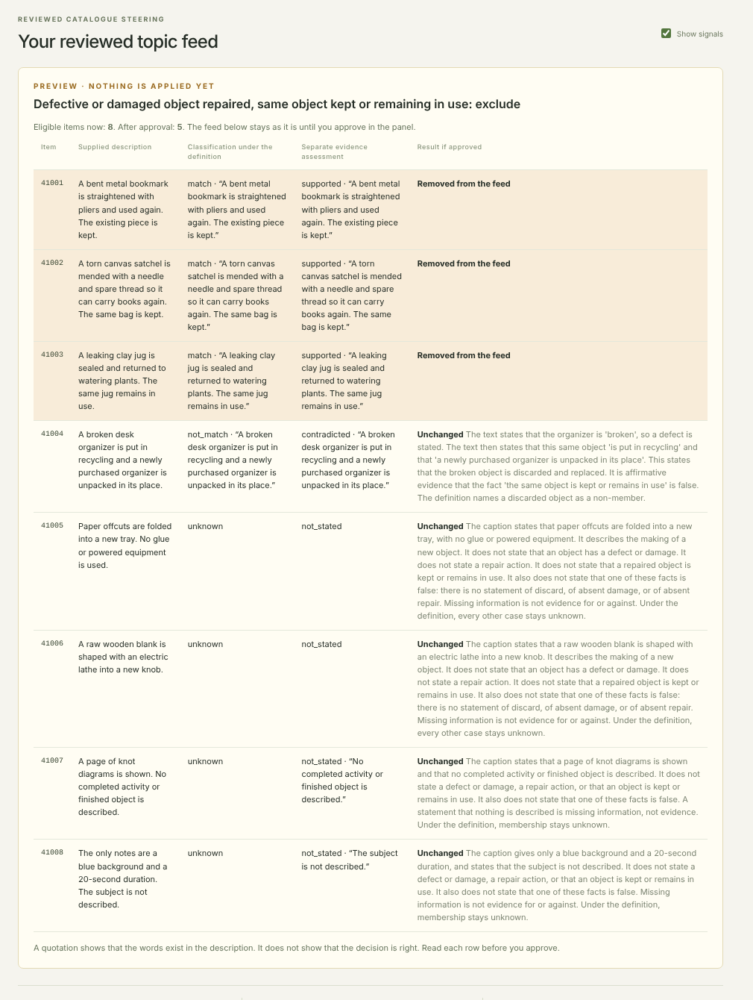

# Natural-language controls for short-video recommendation

**LLM-Mediated Natural Language Controls for Short-Video Recommender Systems: An Offline Study of Controllability.**
COMP 9500 M.Sc. research project at BCIT. Student: Vibhor Malik. Supervisor: Dr Borna Noureddin.

## What this project is

This project studies how a person can control a short-video feed with plain language.
A language model translates a request into a proposal. A person reviews the proposal. A fixed, deterministic policy then applies the approved change to the recommender's ranking.
The study is offline. It uses the KuaiRec dataset (865 users and 2,593 items in the processed subset).
The repository contains a research demonstrator named Feed Control Lab (React and FastAPI), its tests, the paper and presentation sources, and the experiment protocols and results.

## The three controls

**Manual category control.** You choose an existing category and an action. The app filters the feed and does not change the recommender's scores. You can undo the control. This is the baseline for the two language controls.

**A new category from natural language.** You describe what you want. A model proposes a definition, and you review it. The model then classifies every supplied item, and a separate model call assesses the evidence without seeing those decisions. You review every item. The approved set goes to the same deterministic filter as the manual control.

**Indirect requests.** A request does not need to name a category. Example: "I'm not hungry, remove all the stuff that makes me hungry." The model interprets the action and proposes existing items, with a quotation from each description. You review the selection before the app applies it. The app can also ask for clarification.

A proposal never changes the feed. Apply uses exactly the reviewed set. A two-step Undo restores the earlier state.



Two further additions by the student are separate from these controls: a model can write metadata for a fictional item, which goes to a separate feed, and a small comparison of a stronger model with local models exists.

## Current status

[Requirements and evidence](docs/requirements-and-evidence.md) maps each request from the supervisor to the code and to what was observed, including the results that were negative. In short, on 13 November 2026 (the date in Vancouver; the run receipts give UTC times on 14 November):

- all three controls completed in a real browser on the served application: preview without change, Apply of exactly the approved items, and Undo to the identical starting feed;
- the two language controls used real model output through an operator relay, and an AI operator made the review decisions. No human review of those runs exists yet;
- the automatic connection to the Claude Code CLI has not yet completed the whole new-category flow.

Each language control completed three times on a small invented scenario. The last runs used the final application code. One earlier new-category attempt was rejected by the app and its record is kept. These runs show each control running from end to end on these scenarios. They are not an accuracy result.

## Run the demonstration

Python 3.11 or newer.

```
python -m venv .venv
.venv\Scripts\Activate.ps1        # Windows PowerShell
source .venv/bin/activate         # Linux or macOS
python -m pip install -e ".[test]"
```

Start one scenario at a time from the repository root. Stop it with Ctrl+C.

```
python scripts/quickstart.py check
python scripts/quickstart.py rehearse --scenario category
python scripts/quickstart.py live --scenario category --operator cli
python scripts/quickstart.py live --scenario hunger --operator cli
```

Open <http://127.0.0.1:8765>, choose **Reviewed topic feed**, then open **Experimental semantic groups**.

- `rehearse` uses hand-written rehearsal replies. It is not a model. The page shows "AUTHORED REPLIES · NO MODEL".
- `live --operator cli` uses the relay provider, and the Claude Code CLI on your computer answers each request. You review every proposal in the page.
- `live --operator manual` uses the relay provider, and you carry each request to a model yourself.
- A reviewed connection to the Claude Code CLI on Windows (`--provider personal-cli`) also exists. It needs a reviewed configuration file.

The [demonstration guide](docs/demo.md) describes each provider, the review steps and the browser check.

## Run the checks

```
python -m pytest
node --test web/tests/*.mjs
node tests/browser/demo_flows.cjs --base http://127.0.0.1:8765 --scenario category --flows manual,category --out runs/browser-check
```

The Node tests need `npm ci` in `web/` first. The browser check needs Playwright and a running demonstration. PyTorch is needed only for the trained recommender and the original experiments: `python -m pip install -e ".[test,recommender]"`.

## Experiments and results

Every number below is copied from the document named after it.

**Experiment 1.** Protocol: [docs/evaluation-protocol.md](docs/evaluation-protocol.md). Paper: `paper/research-paper-2026-10-19.tex`, with the PDF in `deliverables/2026-10-19/`.

- For boost requests, TCP@10 was 11.615% with item feedback and 79.222% under the category policy. For mute requests, TCER@10 was 6.112% and zero (`deliverables/2026-10-27-feedback/RESULTS-AND-LIMITATIONS.md`). The zero comes from the hard filter. It is policy enforcement by construction, not proof of an LLM advantage.
- Negative: the Llama parser matched 79 of 100 requests exactly. The 85% target was missed (`docs/evaluation-protocol.md`). The rule parser matched 81 of 100 (`deliverables/2026-11-05-final-demo/RESULTS-AND-LIMITS.md`).
- Negative: boost lowered NDCG@10 from 0.03012 to 0.01637 (`deliverables/2026-10-27-feedback/RESULTS-AND-LIMITATIONS.md`).
- Negative: a complete replay of Experiment 1 is not established (`deliverables/2026-11-04-completion-review/E1-REPLAY-DISCREPANCY.md`).

**Experiment 2, with model-generated reference labels.** Protocol, rubric and prompts: `docs/ai-reference-e2-*.md` and `.json`. Results: [docs/ai-reference-e2-results-2026-10-14.md](docs/ai-reference-e2-results-2026-10-14.md). Evidence: `docs/ai-reference-e2-evidence/`.

- Whole-command agreement with the reference labels was 76 of 100 for Llama and 11 of 100 for rules.
- Induced control success was 20.145% for Llama, 3.854% for rules and 3.815% for item feedback.
- Negative: NDCG@10 was 0.02580 for Llama and 0.03184 for item feedback. Conditional-control success was zero (`deliverables/2026-10-27-feedback/RESULTS-AND-LIMITATIONS.md`).
- The reference labels came from models. They do not measure independent human accuracy.

**Synthetic-language study of 4 November.** Protocol and results: `deliverables/2026-11-04-prospective-evaluation/PROTOCOL-AND-RESULTS.md`.

- The pipeline matched the complete intended profile on 48 of 100 supported requests and clarified correctly on 19 of 20 diagnostic requests.
- The 120 cases gave 49 ready proposals, 61 clarifications, five grounding errors and five parser or schema rejections. These cases are now exposed development material.

The complete cases, model responses, ranking outputs and recommender checkpoints are held in a separate research archive, not in this repository.

## Limits

- The demonstration scenarios use eight invented item descriptions and a labelled diagnostic scorer, not the trained recommender.
- There is no user study. Requests are synthetic. The ranking measure is a historical next-item proxy.
- A quotation shows that words are present in a description. It does not show that a membership decision is correct. Two model calls can agree and both be wrong.
- The development examples are small and exposed. They cannot serve as an unseen test.
- The manual control check shows that a control is enforced and can be reversed. It does not show that recommendations are better.

## AI assistance and attribution

- Research provenance and the use of AI assistance: [docs/academic-use.md](docs/academic-use.md) and [the code and contribution map](deliverables/2026-10-27-feedback/CODE-MAP-AND-AI-ASSISTANCE.md). The recent application work, its tests and its documentation were produced with substantial AI assistance, and an AI agent made the review decisions in the 13 November runs and wrote their records. Those documents state what the student did himself.
- Third-party data and software: [NOTICE.md](NOTICE.md). KuaiRec licence: [notices/KuaiRec-LICENSE.txt](notices/KuaiRec-LICENSE.txt).

## More

- [Demonstration guide](docs/demo.md) and [app guide](docs/app.md).
- [Requirements and evidence](docs/requirements-and-evidence.md) and the [13 November run records](docs/evidence/2026-11-13/README.md).
- [Provider adapters](docs/model-provider-adapters.md), [category provider configuration](docs/category-provider-configuration.md), [literal source requirements](docs/numbered-source-constraints.md).
- Dated records of earlier work: [current progress, 11 November](docs/current-progress.md), [5 November demonstration](deliverables/2026-11-05-final-demo/README.md), [4 November audit](deliverables/2026-11-04-completion-review/PROJECT-COMPLETION-AUDIT.md), [19 October paper and presentation](deliverables/2026-10-19/README-2026-10-19.md).
