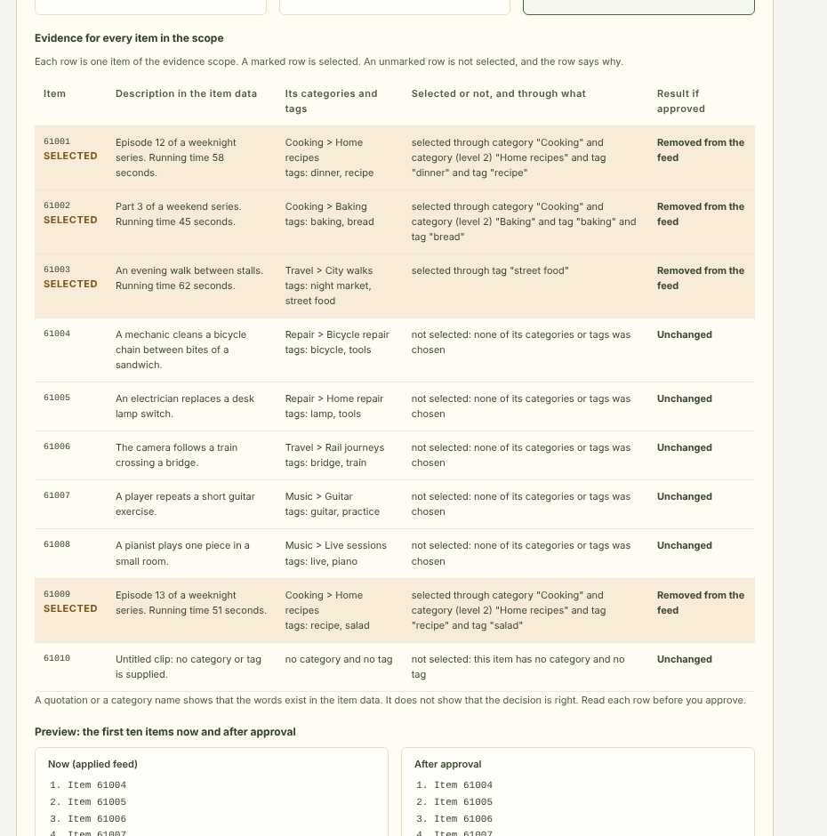

# Natural-language controls for short-video recommendation

**LLM-Mediated Natural Language Controls for Short-Video Recommender Systems: An Offline Study of Controllability.**
COMP 9500 M.Sc. research project at BCIT. Student: Vibhor Malik. Supervisor: Dr Borna Noureddin.

## What this project is

This project studies how a person can control a short-video feed with plain language.
A language model turns a request into an explicit proposal. The application checks the proposal. A person reviews it. A fixed, deterministic policy then applies exactly the approved change to the ranking.

The research question is about controllability and expressiveness.
Which requests can a person state in language? How reliably does a model turn them into an explicit control? What does the control cost in ranking quality?
The project does not claim that a language model makes recommendations more accurate or users more satisfied.

The study is offline. It uses the KuaiRec dataset (865 users and 2,593 items in the processed subset). There is no user study.
The repository holds a research application named Feed Control Lab (React and FastAPI), its tests, the experiment protocols and results, and the paper.

## What the application shows

The view **Language controls** has four methods. Each one follows the same stages: request, interpretation, evidence, preview, Apply, Undo.

| Method | What happens | Model calls |
| --- | --- | --- |
| Existing category | You choose an existing category and an action. This is the reference for the language controls. | 0 |
| A request matched to existing categories and tags | You write a request. It does not need a category name. The model chooses existing category and tag names. The application checks each name and selects the items that carry it. | 1 |
| A request matched to item descriptions | The model reads the direction from the request. It then selects items and cites a quotation from each description. | 2 |
| A new category from a description | The model proposes a definition, and you review it. The model then classifies every item. A separate call assesses the evidence without seeing the classifications. | 3 |

For every method:

- a proposal does not change the feed;
- the review shows what came back, the application checks and your decision in three separate blocks (with the hand-written replies of a rehearsal, the first block is "Authored reply (written by hand, not a model)");
- a table shows each item in the scope and why it is selected or not selected;
- Apply uses exactly the reviewed set, and a two-step Undo restores the earlier feed.

*The evidence table of one review of 14 November 2026 (revision `b7c5a91`, before the merge with the published work branch). The request was "I'm not hungry, remove all the stuff that makes me hungry." The model chose existing category and tag names, and the application selected the items that carry them. The items are invented. The model output came through the file relay, and an AI operator reviewed it; no person reviewed this run. The complete review with its three blocks is in [docs/images/review-three-blocks.png](docs/images/review-three-blocks.png).*

The application also shows these things:

- **Mixed requests.** One request can hold several preferences, for example more of one subject and none of another. The review shows each control, and one approval applies them together.
- **Requests that change nothing.** An ambiguous request, a negated command, a request that the controls cannot express, and a request with no match each give a plain result. Nothing is applied. A negated hide, exclude, remove, reduce or boost (for example "Do not hide ..."), or a negated "show ... more" or "show ... less", matches the negated-command pattern. The application stops it before any model call.
- **A fictional item.** A model writes a title and a description for an item that does not exist. The item goes to a separate feed. It never enters the dataset.
- **Model routes.** The application can reach a model through a command-line program, a hosted API with your own key, a model server on your computer, or by hand. See [model routes](docs/model-routes.md).
- **The original study.** The views "Original study (A to E)" and "Compare A to E" hold the five conditions of the original proposal. They are item feedback, explanations, a free-text category instruction, an editable profile, and all channels. The rule parser of C, D and E reads category IDs of the form `category_N` only. On the bundled scenarios, which have named categories, the instruction and the profile are disabled, and the page says why. The scenario `conditions` serves the built-in fixture, where they work.

The supervisor asked for three of these things in a meeting. The student supplied the transcript of that meeting on 4 November 2026. The three things are the manual category control with measured performance, a new category from natural language, and requests that do not use the literal category words.
[Requirements and evidence](docs/requirements-and-evidence.md) maps each request to code and to evidence.

## Run it in five steps

You need Python 3.11 or newer. [Install and run](docs/install-and-run.md) gives every command for Windows and for macOS.

1. **Install.** Create a virtual environment. Then run `python -m pip install -e ".[test]"`.
2. **Choose a route to a model.** Run `python scripts/quickstart.py setup`. It asks a few questions and writes `model-route.json`. The file never holds an API key.
3. **Confirm the route.** Run `python scripts/quickstart.py doctor`.
4. **Start.** Run `python scripts/quickstart.py start --scenario tags`.
5. **Use the page.** Open <http://127.0.0.1:8765>. The page opens on **Language controls**. The [guide to the language controls](docs/demo.md) describes each method.

Three more commands help:

- `python scripts/quickstart.py rehearse --scenario tags` serves the page with hand-written replies. No model is used. Use it to learn the screens.
- `python scripts/quickstart.py rehearse --scenario conditions` serves the original conditions A to E on the built-in fixture (36 items, categories `category_0` to `category_5`, three users). It uses no model and has no language controls.
- `python scripts/quickstart.py try --scenario tags` runs the bundled requests through your route without the browser. See [route trial](docs/route-trial.md).

The routes for a command-line program, a hosted API and a local model server were tested with stand-in programs and stand-in servers only.
A first real call through those routes on Windows or macOS is still to do. Nothing in this repository was run on Windows or macOS for this revision.

## Experiments and results

Every number below is copied from the document that is named after it.

**Experiment 1 (frozen).** Protocol: [docs/evaluation-protocol.md](docs/evaluation-protocol.md).

- For boost requests, TCP@10 was 11.615% with item feedback and 79.222% under the category policy. For mute requests, TCER@10 was 6.112% and zero (`deliverables/2026-10-27-feedback/RESULTS-AND-LIMITATIONS.md`). The zero comes from the hard filter. It shows that the policy is enforced. It does not show an advantage of the language model.
- Negative: the Llama parser matched 79 of 100 requests exactly. The 85% target was missed (`docs/evaluation-protocol.md`). The rule parser matched 81 of 100 (`deliverables/2026-11-05-final-demo/RESULTS-AND-LIMITS.md`).
- Negative: boost lowered NDCG@10 from 0.03012 to 0.01637 (`deliverables/2026-10-27-feedback/RESULTS-AND-LIMITATIONS.md`).
- Negative: a complete replay of Experiment 1 is not established (`deliverables/2026-11-04-completion-review/E1-REPLAY-DISCREPANCY.md`).

**Experiment 2, with model-generated reference labels (frozen).** Protocol, rubric and prompts: `docs/ai-reference-e2-*.md` and `.json`. Results: [docs/ai-reference-e2-results-2026-10-14.md](docs/ai-reference-e2-results-2026-10-14.md). Evidence: `docs/ai-reference-e2-evidence/`.

- Whole-command agreement with the reference labels was 76 of 100 for Llama and 11 of 100 for rules.
- Induced control success was 20.145% for Llama, 3.854% for rules and 3.815% for item feedback.
- Negative: NDCG@10 was 0.02580 for Llama and 0.03184 for item feedback. Conditional-control success was zero (`deliverables/2026-10-27-feedback/RESULTS-AND-LIMITATIONS.md`).
- The reference labels came from two AI annotators. They do not measure independent human accuracy.
- The two annotators are AI roles. They carry first names in the frozen file paths (`annotations/khushi/`, `annotations/tanishq/`), and no person of those names made the labels.

**Synthetic-language study of 4 November (used once, now exposed).** Protocol and results: `deliverables/2026-11-04-prospective-evaluation/PROTOCOL-AND-RESULTS.md`.

- The pipeline matched the complete intended profile on 48 of 100 supported requests. It clarified correctly on 19 of 20 diagnostic requests.
- The 120 cases gave 49 ready proposals, 61 clarifications, five grounding errors and five parser or schema rejections.
- The intended profile (the model-written reference, applied without a model) against the language pipeline: the intended profile changed top-ten exposure by 5.3579 percentage points, and the model-proposed profile by 2.9292 points. These are signed descriptive averages. They are not a success rate. An AI author wrote the intended profiles, and another AI role reviewed them. They are not human annotations.

The complete cases, model responses, ranking outputs and recommender checkpoints are in a separate research archive. They are not in this repository.

The paper is in [`paper/`](paper/README.md). The current draft is `paper/research-paper-2026-11-14.pdf`. It reports the runs of 14 November on the integrated revision `ff92666`, and it is not ready for submission. The paper of 19 October is a dated record in `deliverables/2026-10-19/`.

## Experiment evidence and demonstration evidence

Keep three kinds of evidence apart.

**Experiment evidence** comes from a study with a protocol that was fixed before the run: Experiment 1, Experiment 2 and the 4 November study. Their inputs, prompts, labels and results stay as they are.

**Demonstration evidence** is a recorded run of the application on a small invented scenario. It shows that a control ran from request to Undo. It is not an accuracy result.

- *13 November 2026, earlier revisions (`26a0b16` to `936d0f4`).* The manual control, a new category and an indirect request matched to descriptions each completed in a real browser. The model replies came through a file relay. An AI agent made the review decisions. No person reviewed those runs. Records: [docs/evidence/2026-11-13](docs/evidence/2026-11-13/README.md).
- *14 November 2026, the package line before the merge.* On revision `b7c5a91` (source fingerprint `ab1a9d846b33...`), every method completed in a real browser with real model output through the file relay: the request matched to existing categories and tags, a mixed request, the request matched to item descriptions, the new category in stages and the fictional item, with the manual control as reference (13 model calls, 308 script checks passed). Four requests that must change nothing changed nothing. An AI operator made all 19 review decisions; no person has reviewed a run. The model name is declared, not attested. Records: [docs/evidence/2026-11-14/](docs/evidence/2026-11-14/README.md).
- *14 November 2026, the integrated revision.* The published work branch and the package line were merged (`e797ce1`). A comparison of every line of the published branch and two independent reviews of the merge gave corrections (revision `ff92666`, source fingerprint `22ba794e2091...`). The revision has the prompts of the published branch for the new category and the page and routes of the package line. Between 20:05 and 20:13 UTC every method completed on it in a real browser with real model output through the file relay (13 model calls, 321 script checks passed), and the four requests that must change nothing changed nothing. An AI operator made all 19 review decisions; no person has reviewed a run. The model name is declared, not attested. Two earlier passes of the same runs on the merged source selected the same items. Records: [docs/evidence/2026-11-14-integrated/](docs/evidence/2026-11-14-integrated/README.md).

**Software tests** use hand-written replies, stand-in servers and stand-in programs. They check program behaviour. They are not model evidence.

## Limits

- The demonstration scenarios use invented item descriptions and a labelled diagnostic scorer. They do not use the trained recommender.
- There is no user study. Requests in the experiments are synthetic. The ranking measure is a historical next-item proxy.
- A quotation or a category name shows that words exist in the item data. It does not show that a membership decision is right. Two model calls can agree and both be wrong.
- The development examples are small and exposed. They cannot serve as an unseen test.
- The manual control check shows that a control is enforced and can be reversed. It does not show that recommendations are better.
- A like-for-like comparison of a local model and a stronger model has not been run. The earlier six-case comparison used different transports and settings.
- A fictional item is authored demonstration data. It is not a new playable item of the research dataset.

## AI assistance and attribution

- Research provenance and the use of AI assistance: [docs/academic-use.md](docs/academic-use.md) and [the code and contribution map](deliverables/2026-10-27-feedback/CODE-MAP-AND-AI-ASSISTANCE.md). The recent application work, its tests and its documentation were produced with substantial AI assistance, and an AI agent made the review decisions in the 13 November runs and wrote their records. Those documents state what the student did himself.
- Third-party data and software: [NOTICE.md](NOTICE.md). KuaiRec licence: [notices/KuaiRec-LICENSE.txt](notices/KuaiRec-LICENSE.txt).

## Map of the repository

| Path | Content |
| --- | --- |
| `feedctrl/` | The application and the experiment code (Python). |
| `web/` | The interface source and the built interface (`web/dist`). |
| `scripts/` | The quick start, the launcher, the route tool, the relay tools, the checks of the source list and of the built interface, and the experiment scripts. |
| `scenarios/`, `tools/hosted_validation_current/inputs/` | The three bundled scenarios with invented items. |
| `tests/` | Python tests, the browser check and the stand-ins. |
| `docs/` | Guides, protocols, results and run records. Start with the [index](docs/README.md). |
| `deliverables/` | Dated records of earlier work. |
| `paper/`, `presentation-bcit/` | Paper and presentation sources. |
| `tools/` | The validation driver for the reviewed Claude Code CLI connection. Its inputs and templates are the frozen profile of 11 November 2026. |
| `CURRENT-SOURCE-SHA256.txt` | The SHA-256 of every tracked file of this revision. `python scripts/refresh_source_manifest.py --check` compares it. |
