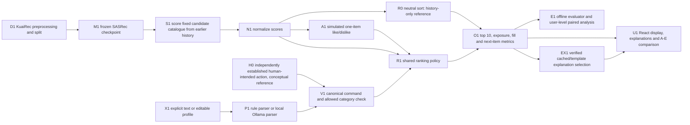

# Pipeline and code walkthrough

Prepared 27 October 2026 from FP checkout `bec8442dd7fbd43535ded943f886add2cb50cd8d`. The diagram is editable Mermaid. It traces the implemented local app and separates an **uncontrolled history-only score path**, **a conceptual human interpretation reference**, and **the implemented LLM parser path**. The app has no dedicated human-interpreter backend, and this diagram does not claim one was evaluated.

The manual branch means a person establishes the intended category and operation **outside** the evaluated parser, then that structured command would enter the same validator/policy. The current UI can receive an explicit command or profile; it does not authenticate a human oracle. Comparing two LLM outputs does not make H0 human ground truth.

| Block | Actual code and input to output | Failure or limit |
| --- | --- | --- |
| D1 | `feedctrl/data.py:91-194` preprocesses public KuaiRec records into catalog, user histories and split metadata; `load_data`/`validate_data` at lines 31-57. | Split and provenance must be checked from saved manifest. Test events must not enter request generation or scoring. |
| M1 | `feedctrl/model.py:26-88` builds the independently written SASRec variant; `train_model` at 106-192 saves checkpoints; `load_model` at 224-237 loads them. | The project does not claim bit-identical reproduction of an upstream SASRec implementation. |
| S1 | `DemoState.rank` in `feedctrl/api.py:140-149` scores the same sorted catalog from `train + request_history`. `SASRecPredictor.score` at `model.py:203-223` returns per-item scores. | Without a checkpoint, the app uses a deterministic diagnostic scorer and labels that mode. For this packet, the saved seed-42 checkpoint was required. |
| N1/R0 | `controls.normalize_scores` at 297-305 and `rerank` at 326-339 give the neutral history-only sort when command/profile are empty. | R0 is a reference calculation, **not** named Condition A once item feedback is applied. There is no separate R0 condition in the current A-E interface. |
| A1 | `api.py:150-157` applies an item-specific +0.25 like or excludes a disliked item from A/B output; `/api/feedback` at 295-305 stores the latest choice, while `clear` removes that stored choice. The offline proxy is `evaluation.item_feedback_ranking` at 75-84. | KuaiRec does not supply observed thumbs-up/down. Item feedback and category-wide control differ in intervention scope. |
| H0 | Human/manual intent would be recorded independently in a prospective annotation sheet or fixed scenario. | No separately implemented human parser or new held-out human ranking run is claimed here. The 20 October student worksheet is a completed descriptive comparison with AI-authored labels. |
| X1/P1 | `/api/control` and `/api/profile/text` at `api.py:243-293` pass text to `controls.parse_control` (243-254) or `parse_profile` (257-294). Rule and Ollama are selectable. | Current app accepts explicit `category_N` IDs, not arbitrary named topics. Ollama failure returns HTTP 502 and preserves previous state; it is never silently replaced by a rule success. |
| V1 | `controls._validate_control` at 104-119 checks schema, operation, fixed strength and allowed category. `parse_control` at 250-253 checks exactly one explicit category ID against the text; `parse_profile` at 291-292 checks profile grounding. | Invalid, ambiguous, unsupported or ungrounded input fails or clarifies; a valid command can still disagree with reference intent. |
| R1 | `controls.apply_to_profile` at 308-323 applies the explicit same-category command last; `rerank` at 326-339 excludes any item with a muted category and adds boost weights before sorting. `api.py:153-160` selects channels by A-E condition. | `mute` means hard exclusion in current code. The rule parser also treats `less/fewer` as hard mute, not graded decrease. A proposed soft decrease is not implemented. |
| O1/E1 | `evaluation.ranking_metrics` at 51-72 calculates TCP/TCER, fill, HR@1 and NDCG@10 from top K. `experiment2_evaluation.py` owns the separate revised E2 analysis. | The evaluator measures synthetic assigned control compliance and historical next-item agreement, not satisfaction or an actual new user request. Users, not request-seed rows, are the analysis unit. |
| EX1/U1 | `explanations.py:20-86` can generate constrained-fact explanations with local Ollama or a labelled template, while `cached_explanation` selects verified saved signals for live cards. `web/src/main.jsx:22-55` calls the API and refreshes feed/compare; `api.py:229-241` returns A-E views. | An earlier LLM may have selected cached explanation facts; that display path does not change rank. B is ranking-identical to A, and no human response to explanations is measured. The private guided overlay is not public app source. |

## One request trace to say aloud

1. User 14's earlier interaction history and the frozen seed-42 checkpoint produce the same base score vector for every condition. The clean neutral top three in the 27 October in-process receipt are `8958, 7383, 1116`.
2. In A, one like on item `1116` adds an item-only preference. B shows explanations while retaining A's item order. This is the manual UI feedback comparison, not the untouched history-only reference.
3. In C, `Show me more category_1` goes to the selected parser. The **rule** parser in the reproducible receipt returns `boost category_1`; the validator checks its allowed explicit ID. The shared policy adds its 0.25 weight to catalog items with that category. C's top item becomes `10138` and nine of ten items carry `category_1` in that one demo example.
4. In D, a saved `Show me more category_1.` profile produces the same top ten in this example. In E, combining the matching command and profile does not double the weight. A conflicting explicit mute wins and removes category_1 items.
5. The browser labels parser provenance. Switching to Ollama would be a separate live inference call. The rule-mode example is not evidence that an LLM uniquely changed the feed.

For the professor's main question: the **parser** is where LLM capability might add value to control interpretation. The separate cached explanation path may use constrained Llama fact selection, but explanation display does not rerank and its human value was not measured. The recommender, candidate set, normalized scores and enforcement policy stay fixed. E1 canonical rule and Llama rankings are identical; fresh model-reference E2 measures a narrower interpretation advantage with model-generated references and a quality cost. See `EVALUATION-EXPLAINED.md` and `RESULTS-AND-LIMITATIONS.md` before claiming user benefit.

## Open the core code in this order

The four-page PDF is a presentation map. These are the source-level blocks to open when asked how it actually works. Paths refer to this checkout, not to a third-party SASRec repository.

| Stop | Function and input | Output and next call | Question to answer aloud |
| --- | --- | --- | --- |
| 1. Dataset | `data.preprocess_kuairec(archive_path, output, ...)` at `data.py:91` reads the KuaiRec archive; `validate_data` at 38 checks processed structure. | Saved processed catalog, user histories, chronological windows and categories. `api.DemoState` loads this file or an explicitly labelled fixture. | Which events train the model, which form request history, and which are held out? Why does a request derived from earlier history still differ from a genuine user request? |
| 2. Training | `model._build_network` at `model.py:26` defines embeddings, position and attention blocks; `_training_examples` at 89 constructs sequence targets; `train_model` at 106 trains and saves a seeded checkpoint. | `load_model` at 224 returns `SASRecPredictor`; `score(history, item_ids)` at 203 returns one base score per candidate. | The method is SASRec-style but the implementation is independent. Point out the saved checkpoint and candidate catalog rather than describing a pretrained recommender. |
| 3. API state | `api.DemoState.__init__` at `api.py:82` selects processed or fixture data and trained or diagnostic scorer. `create_session`, `user_state`, `initial_profile` at 99-136 isolate user preferences by session. | `/api/status` at 205 exposes mode/provenance; `/api/users` and `/api/categories` at 221-226 populate choices; `/api/feed` at 230 requests `DemoState.rank`. | Before any result, read the data, model and parser badges. A fixture or diagnostic response is not evidence of the trained-data pipeline. |
| 4. Score and item proxy | `DemoState.rank` at `api.py:140-187` scores the common sorted catalog from train plus request history, normalizes scores and selects A-E channel effects. `/api/feedback` at 296 stores the latest item choice. | Neutral sort R0 or A/B one-item adjustment, then `controls.rerank`. `FixturePredictor` at `model.py:238` is diagnostic only. | History-only R0 is untouched; A has simulated item feedback. Likes affect one item, while category control can affect many. |
| 5. Interpretation | `controls._rule_control` at 224 or `_llm` at 179 receives explicit text and allowed categories. `_llm` calls a loopback Ollama endpoint through `_request` at 148; `parse_control` at 243 selects backend. `parse_profile` at 257 handles profile text. | Structured operation, category and parser provenance enter `_validate_control` at 104. `/api/control` and `/api/profile/text` at `api.py:244-293` update session state only after success. | The LLM does not train SASRec or directly sort items. Rule and LLM are alternative interpreters of the same text; malformed/unavailable Ollama does not silently fall back. |
| 6. Policy | `controls.normalize_scores` at 297, `apply_to_profile` at 308 and `rerank` at 326 take fixed base scores, candidate IDs/categories, item feedback and validated category weights. | Stable sorted feed with muted-category items removed. `DemoState.rank` emits cards and explanation fields. | Show one item score change and one excluded category. `less/fewer` maps to hard mute because quantitative soft decrease is unsupported. Explicit `category_N` is required; a narrow parse is not universal language understanding. An explicit same-category command replaces the profile effect. |
| 7. Frontend | `web/src/main.jsx` obtains session/status, calls feed and compare endpoints, submits feedback/control/profile/reset requests, then refreshes visible state. `/api/compare` at `api.py:237` calls A-E ranking on the same user state. | Cards, count, status badges, notices, explanatory text and A-E comparison. `explanations.cached_explanation` at `explanations.py:78` serves verified display text. | B has A's order because explanations are display-only. A browser screen can demonstrate handlers, not prove offline statistical results. |
| 8. E1 evaluation | `evaluation.generate_requests` at `evaluation.py:23` assigns synthetic earlier-history requests. `ranking_metrics` at 51 computes exposure, fill and next-item quality. `run_evaluation` at 109 records conditions; `analyze_rows` at 355 performs paired user-level analysis. | Frozen E1 tables and plots. `parser_benchmark.run_parser_benchmark` separately scores the 100-utterance bank with a Wilson interval. | State denominators and analysis unit. E1 canonical rule and Llama feed rankings match; the control effect is shared enforcement, not unique language ability. |
| 9. Revised E2 | `experiment2_controls.validate_command` at 115 and `parse_control` at 425 handle the separate compound grammar; `rerank` at 472 handles that experiment's policies. `experiment2_evaluation.evaluate_ranking` at 225 and `analyze_rows` at 369 score saved cases. | Separate fresh AI-reference E2 outcomes, with its own manifest and evidence. The original human-reference route and its no-go decision remain archived. | Compound/floor/conditional E2 code is **not** wired into the live A-E API. Do not demonstrate an E2 feature in the original UI or combine E1 and E2 denominators. |

### One feed request with values

1. `GET /api/feed?user_id=14&condition=A` reaches `api.feed` and `DemoState.rank`. The saved seed-42 predictor scores the same catalog from earlier user-14 history. The clean neutral top three in the in-process receipt are `8958, 7383, 1116`.
2. `POST /api/feedback` with a like for `1116` stores one item choice. A and B now place `1116` first; B adds only explanatory display text. Repeating the same test through B is not a new treatment on the score vector.
3. `POST /api/control` with `Show me more category_1` and rule backend calls `controls.parse_control`, validates one allowed category, then stores the command. In C, `rerank` boosts matching-category candidates by the defined weight; this receipt has nine matching items in the top ten. Switching backend to Ollama would be a separate call whose parsed output and provenance must be inspected.
4. `POST /api/profile/text` with an equivalent explicit category preference gives D the same category policy; E combines profile and command but does not double the weight. A later explicit mute for that category gives zero exposure because the policy removes matching candidates. This is mechanical compliance, not proof of what a person wanted.
5. `evaluation.ranking_metrics` counts target-category items in the first ten and checks fill and historical next-item quality. It does not measure preference satisfaction. The reproducible receipt in this packet is one saved-data rule-mode example, not a new statistical experiment.

### Checks and failure boundaries

| Boundary | Code or test family | What it establishes |
| --- | --- | --- |
| Split and model | `tests/test_data.py`, `tests/test_model.py` | Processed structure, sequence/model behavior and saved scoring contracts. It cannot certify proposal approval or human intent. |
| Parser and policy | `tests/test_controls.py`, `tests/test_experiment2_controls.py` | Validated grammar, grounding, hard mute, precedence, and separate E2 compound behavior. A passing compound test does not add that feature to the live A-E API. |
| Stateful app and display | `tests/test_api.py`, `tests/test_output_safety.py`, browser acceptance receipts | Sessions, reset/state preservation, response contracts and display behavior. An HTTP-only check is not a visual browser rehearsal. |
| Evaluation and freeze | `tests/test_evaluation.py`, `tests/test_experiment2_evaluation.py`, `tests/test_frozen_e1_manifest.py` | Metric arithmetic, analysis contracts and frozen-input checks. A passing archive hash validates bytes; it is not an independent scientific replay or a human-interest result. |
