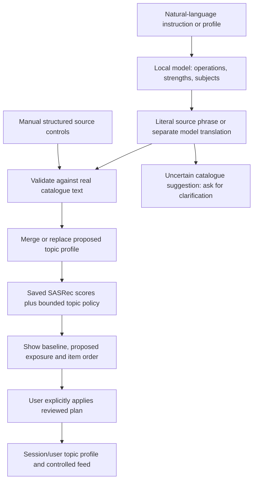
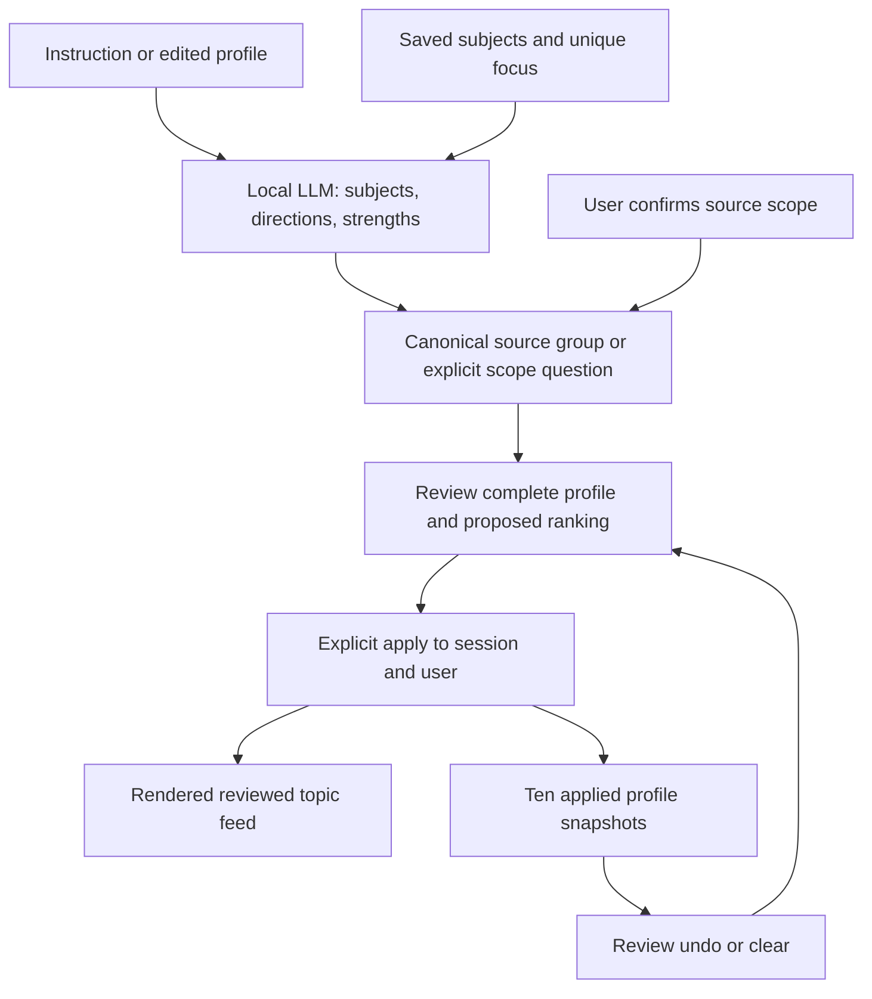

# Reviewed natural-language catalogue steering, 4 November 2026

## Complete project review

The [33-clause proposal audit](../2026-11-04-completion-review/PROJECT-COMPLETION-AUDIT.md) assesses the actual supplied five-page proposal, the later professor feedback and all five course assessment components. It supersedes treating software readiness as fulfillment of every original research promise. The prototype and recorded evaluations exist; method departures, the missed 85% parser target, ranking-quality costs and unestablished independent channel/LLM benefits remain explicit. The original human-reference route and completed hours reconciliation are not reopened.

The [current seven-page paper review](../2026-11-04-completion-review/COMP9500-Current-Paper-Review.pdf) matches the current paper source; the older dated PDF remains a historical publication. Personal presentation, supervisor acceptance and submission are not claimed completed by these files.

Current cache preparation restored the original ten records without modification and added fifteen local Llama selections in a separate dated prototype directory. The [served coverage receipt](../2026-11-04-completion-review/CACHE-COVERAGE-RECEIPT.json) verifies all 25 declared worked-case items, ten cached-model cards in each tested B/E case and unchanged rankings. This is worked-case coverage, not all catalogue/user contexts or a new scientific experiment. Other contexts retain labelled template explanations. The optional configuration and preparation command are below.

After that backend configuration change, the full suite completed **314 passed, one private-bank skip and two dependency warnings**. The skip is the static split check for private parser banks absent from this public review checkout. No frontend source changed in this pass; the previous successful Vite build remains the applicable frontend check.

A later full-suite check at published source `ef1bf295` completed **316 passed, one private-bank skip and two warnings**. The confirmed-scope repair also has 40 affected workflow/API checks and a fresh rendered review/apply/undo receipt. These software checks do not establish a new language benchmark result.

The new **Reviewed topic feed** view supports several topic instructions, three increase/decrease strengths, hard exclusion and an editable topic profile. It uses the real saved-model catalogue and official caption sidecar. It has no YouTube connection and does not change frozen A-E experiments.

An installed local Qwen 2.5 Coder 7B model interprets requests. The model proposes a plan; the user reviews the exact source subjects and proposed feed before applying it. Choosing a source phrase is not a validated new ontology or evidence of human relevance.

## Professor meeting sequence, 18-20 minutes

This is the current presentation route, not evidence of a student's rehearsal or a new benchmark. Start from the [seven-page paper review](../2026-11-04-completion-review/COMP9500-Current-Paper-Review.pdf), [pipeline walkthrough](../2026-10-27-feedback/PIPELINE-AND-CODE-WALKTHROUGH.md) and [current source/contribution map](../2026-10-27-feedback/CODE-MAP-AND-AI-ASSISTANCE.md). A source-pinned five-page repository visual is a companion attachment; it maps all 168 tracked files at ef1bf295. The two new result documents in the [separate prospective evaluation](../2026-11-04-prospective-evaluation/PROTOCOL-AND-RESULTS.md) postdate that snapshot. Private datasets are not part of the tracked-file map.

| Time | Show, operate and explain |
| --- | --- |
| 0:00-1:30 | Open the real app on port 8772. Read processed-data, trained-model and sidecar status. Reload an expired session; choose user 14, reset, Explore feed and A. Confirm zero preferences and the observed clean order. Metadata cards are not playable videos. |
| 1:30-3:00 | Use the repository visual and three pipeline paths. Earlier history supplies fixed candidate scores; manual intended commands bypass language parsing; the local model proposes commands for the same deterministic policy. Open the linked functions, not historical line numbers. |
| 3:00-7:00 | Like item 1116 in A; B should retain A's order and add cached verified explanations. In C apply `Show me more category_1` using the labelled rule diagnostic. Save the equivalent preference in D, show combined E and Compare A-E. The saved matched example has 9/10 targets, not a universal guarantee. Explicit mute wins a conflicting same-category profile boost. Reset. Original A-E less/fewer means hard mute. |
| 7:00-11:00 | Select Reviewed topic feed and read the configured model. Review `A lot more Qingdao.` If grounding suggests broader travel, choose the literal source phrase `青岛` and review again. Read strong +0.40, five source matches and the proposed order before Apply. The recorded technical example has 4/10 matches and full fill. A scope choice is explicit manual assistance, not autonomous semantic accuracy. |
| 11:00-14:00 | Contrast a light decrease with hard exclusion: reduction keeps matches eligible; exclusion removes them. Select replacement-profile mode and review a complete two-subject profile, checking both source groups and operations. Show that Apply replaces the old profile, then review/apply undo and verify restoration. Global reset clears controls/history; it is not undoable. If a model result is wrong, retain the error/clarification and use clearly labelled manual exact-source mode or saved evidence. |
| 14:00-17:00 | Walk through `interpret`, `ground_actions`, `compose`, `rank`, API preview/apply and the React handlers. Explain fixed offsets, overlap/exclusion precedence, revision/expiry and state isolation. Displayed source-text membership is not validated relevance; no actual YouTube algorithm is controlled. |
| 17:00-20:00 | Show TCP/TCER arithmetic, results and the full proposal audit. Keep E1's 79/100 parser miss, rule/LLM equality, quality decline, E2 zero conditional success and replay limit visible. Attribute the student's reported vision, LLM code generation, line-by-line review and Git push as his account; later assistant changes are separate. State which work is prepared, actually executed or still awaiting feedback. Show the separate frozen synthetic-language result: 48/100 supported profiles correct and 19/20 correct diagnostic clarifications. Its strict first-pass failures remain findings, with no test-bank tuning. |

The technical receipts document prior software checks. They do not establish personal rehearsal, human ground truth or final supervisor acceptance. The original [12-15 minute A-E script](../2026-10-27-demo/PROFESSOR-DEMO-SCRIPT.md) remains a dated subset of this route.

## Pipeline implementation



| Block | Actual implementation |
| --- | --- |
| Real source text and coverage/hash checks | `feedctrl/semantic_controls.py:load_topic_index` |
| Bounded multi-topic plan and strict validation | `feedctrl/semantic_workflow.py:interpret`, `validate_plan` |
| Separate translation, stable subject names and source membership | `ground_actions`, `catalogue_labels`, `known_bindings`, `confirmed_bindings`; one canonical phrase per group |
| Composition and score policy | `compose`, `rank` |
| Review, apply, remove, undo and session isolation | `feedctrl/api.py`, `/api/steering*`, `DemoState.steering_feed`, `steering_snapshot`, `steering_remember` |
| Natural-language/profile editor and confirmation | `web/src/SteeringPanel.jsx` |
| Actual controlled feed cards | `web/src/main.jsx`, Reviewed topic feed view |

The original [pipeline/code walkthrough](../2026-10-27-feedback/PIPELINE-AND-CODE-WALKTHROUGH.md) remains the guide to the original history/manual/LLM A-E prototype. This is a later optional workflow, not a reinterpretation of its results.

## What the controls mean

Up to eight saved subjects are supported. Light, standard and strong mean fixed score offsets of 0.10, 0.25 and 0.40, not percentages or learned preference intensities. Increase adds an offset; decrease subtracts it while keeping items eligible. Hard exclusion removes the matched items. Overlapping offsets add, capped at +/-1.0 per item; exclusion wins an overlap. Ties use ascending item ID. Empty or underfilled lists are not filled by relaxing exclusions.

An instruction merges or replaces settings by the resolved source subject. Replace-profile mode replaces the entire reviewed topic profile. Individual subjects can be removed. Reset this user clears topic controls and the original demo controls. Profiles are temporary and isolated by session and dataset user; reloading creates a fresh session.

Review does not change active preferences. Apply accepts only the most recent server-held plan for that user/session, for five minutes, and rejects a changed revision. An unresolved clause prevents the entire proposed update. Duplicate/conflicting subjects, generic medium words, missing source text and unsupported constraints ask for clarification. Operational model errors remain visible; no rule parser is silently substituted.

The model's source-label suggestion is **not automatically accepted** merely because the label exists or the model calls it equivalent. If the label is not explicitly in the request, the interface asks for confirmation of its scope. The user may insert that exact phrase and review again, refine the request, or use manual source controls.

## Current dialogue, scope and undo update

See the [19-row transcript and capability audit](CAPABILITY-AND-TRANSCRIPT-AUDIT.md) and [final served receipt](dialogue-final-receipt.json). The current workflow adds saved-subject context, explicit source-scope bindings, removal distinct from exclusion, and reviewed undo/clear. A single last-applied subject can be called “that”; multiple subjects require a name. User-confirmed source scope is retained across languages and follow-ups. A model direction contradicting a clear named English clause is rejected, without creating a rule command.

10/11 predeclared topic/direction/strength checks matched; failures: editable_profile. The replacement-profile failure is retained in that receipt. After the confirmed-alias correction, the separate profile/undo audit passed: True; it compared complete feeds with a predeclared manual profile.

The rendered browser also verified scope confirmation, review/apply, contextual light-to-strong increase, actual changed item cards, reviewed undo, reset and the original A-E comparison. The complete API run retained nonempty original A-E preferences until its explicit global reset. This is a bounded local prototype, not universal language understanding or evidence of recommendation benefit. Earlier failures and the travel-scope mismatch below remain historical evidence.

The pre-cache dialogue checks completed **313 Python tests passed, 1 private-bank skip, 2 dependency warnings; Vite build passed**. The focused workflow suite contains 21 checks. The latest backend regression is reported above. The local served port is **8772**. Start from a fresh server process after source updates; a cached page or occupied older port does not prove the current backend is loaded.



The original launch commands below remain usable on a fresh chosen port. To reproduce the dialogue checks, use `python scripts/reproduce_dialogue_steering.py http://127.0.0.1:8772 NEW_RECEIPT.json`. Add `--profile-only` for the final corrected replacement/undo check. The script refuses an existing output path and records rejected/failed cases rather than silently substituting a rule parser.

## Earlier same-day evidence, before the dialogue update

The [served receipt](served-smoke-receipt.json) records development examples on the processed dataset, saved seed-42 scorer and official sidecar. It contains no session/review tokens or raw captions. These are mechanism checks, not an unseen benchmark or participant study.

| Check | Observed result |
| --- | --- |
| English: much more Qingdao, slightly less gaming, hide travel | Three controls interpreted and explicitly applied; Qingdao `+0.40` matched 5 items and showed 4/10; gaming `-0.10` matched 11 and showed 0/10; travel resolved to `旅行`, matching 60 items |
| Chinese: the corresponding three controls | Three controls interpreted; source `旅游` matched 69 items; complete proposed feed equalled the predeclared manual three-control feed |
| English/manual comparison | **Not equal**: English `旅行` and manual `旅游` define different source groups. This remains a semantic-scope limitation, not a pass |
| Light English Qingdao increase | `+0.10`, 5 source matches, 1/10 shown |
| Light English Qingdao decrease | `-0.10`, 5 source matches, 1/10 shown; items remain eligible |
| Strong Chinese Qingdao decrease | `-0.40`, 5 source matches, 0/10 shown; items remain eligible |
| English hard Qingdao exclusion | Exactly 5 matches removed, 0/10 shown, full fill |
| Editable profile | Replacement reviewed and applied; individual removal and reset completed |
| Ambiguity and unsupported quota | Explicit clarification, no active change |
| Cooking scope | Catalogue suggested `美食` (food), which may broaden cooking; clarification required and no controls applied |
| Isolation | Every A-E feed response stayed equal; another session had no saved topic controls; final reset left the topic profile empty |

The Qwen model digest in these calls is `dae161e27b0e90dd1856c8bb3209201fd6736d8eb66298e75ed87571486f4364`, Ollama 0.34.0. The new workflow's default is `qwen2.5-coder:7b-instruct`, overridable with `FEEDCTRL_STEERING_MODEL`. The original A-E and earlier single-topic paths retain their separate Llama configuration. No model was downloaded or trained for this change.

Earlier checks completed: **305 Python tests passed, 1 private-bank skip, 2 dependency deprecation warnings; 13 new workflow tests passed; Vite build passed.** The skip requires private parser banks absent from this review checkout. The focused tests cover composition, atomic review/apply, profile replacement/removal/reset, expiry, session/user isolation, state-preserving errors, clarification, source selection and matched-intent manual/model equality.

The rendered browser was also exercised. A two-topic English request produced a review with five Qingdao matches and eleven gaming matches; applying it displayed four Qingdao matches in the top ten and two saved controls. A cooking request showed the scope clarification while preserving those controls. Inserting the suggested exact source phrase required a second review and did not apply it automatically. Reset/reload returned user 14 to zero topic controls and baseline 8958, 7383, 1116; switching to user 19 and back kept profiles isolated. This was a technical walkthrough, not a student's personal rehearsal or a human-intent evaluation.

## Reproduce and demonstrate

Set `FEEDCTRL_DATA`, `FEEDCTRL_MODEL` and `FEEDCTRL_CAPTION_SIDECAR` to the unchanged processed JSON, saved model directory and official CSV. In separate terminals, run the already installed local runtime and the app:

```powershell
ollama serve
$env:FEEDCTRL_STEERING_MODEL='qwen2.5-coder:7b-instruct'
python -m uvicorn feedctrl.api:app --host 127.0.0.1 --port 8772
```

For the new worked-case explanation cache, set `FEEDCTRL_EXPLANATION_INDEX` to the prepared `results/experiment2/prototype-explanation-cache-20261104/index.json` before starting the app. If that private generated cache is unavailable, prepare a new directory using the existing processed data, installed Llama model and original explanation index:

```powershell
python scripts/prepare_demo_explanations.py --data "$env:FEEDCTRL_DATA" --reference-cache results/explanations.json --output results/experiment2/NEW-WORKED-CASE-CACHE
```

The command refuses an existing destination, records a manifest and retains failures. It never overwrites the reference cache or frozen study outputs. Assign the resulting `index.json` to `FEEDCTRL_EXPLANATION_INDEX`. Without the override, the original cache path remains the default. An absent or incompatible cache entry is visibly labelled as a verified template; it is not represented as fresh LLM inference.

Build the frontend with `npm ci` and `npm run build` in `web/` if needed. Do not start a second runtime if one already owns its port. No software/model download is automatic. Open the local app, check processed-data/trained-model badges, choose user 14 and **Reviewed topic feed**, enter the English composed request above, review the subjects/counts and apply. Use replacement mode to edit the profile; show removal, clarification and reset. Read the source names aloud rather than treating every translation as the same semantic group.

With the configured server running, save a new receipt path:

```powershell
python scripts/reproduce_reviewed_steering.py http://127.0.0.1:8772 NEW_RECEIPT.json
```

The script refuses to overwrite a receipt. It uses a fresh session, records both successes and limitations, and ends by resetting that test user. Saved receipts are the offline fallback; present them as saved execution evidence when a runtime is unavailable.

## Remaining boundaries

Source matching can miss synonyms or select a poor interpretation. The travel mismatch above demonstrates this directly. English and Chinese examples ran; general multilingual reliability was not measured. Numeric quotas, conditional/exception rules, include-only filters, retraining, new catalogue items and arbitrary access to a real platform are outside this workflow and require clarification rather than an invented action. Other model suggestions can still be wrong and must be reviewed.

The manual policy has the same ranking as the model path when their grounded commands match. The LLM contribution is language interpretation and composition, not a better reranker. A changed feed, fixed strengths and source-text counts do not establish human satisfaction or superiority. The completed revised AI-reference study and its negative findings remain separate. No frozen prompts, data, labels, models, results or reserved tests were edited. AI assistance was used for this extension's implementation, tests and documentation; the existing contribution worksheet retains personal entries for student confirmation.
