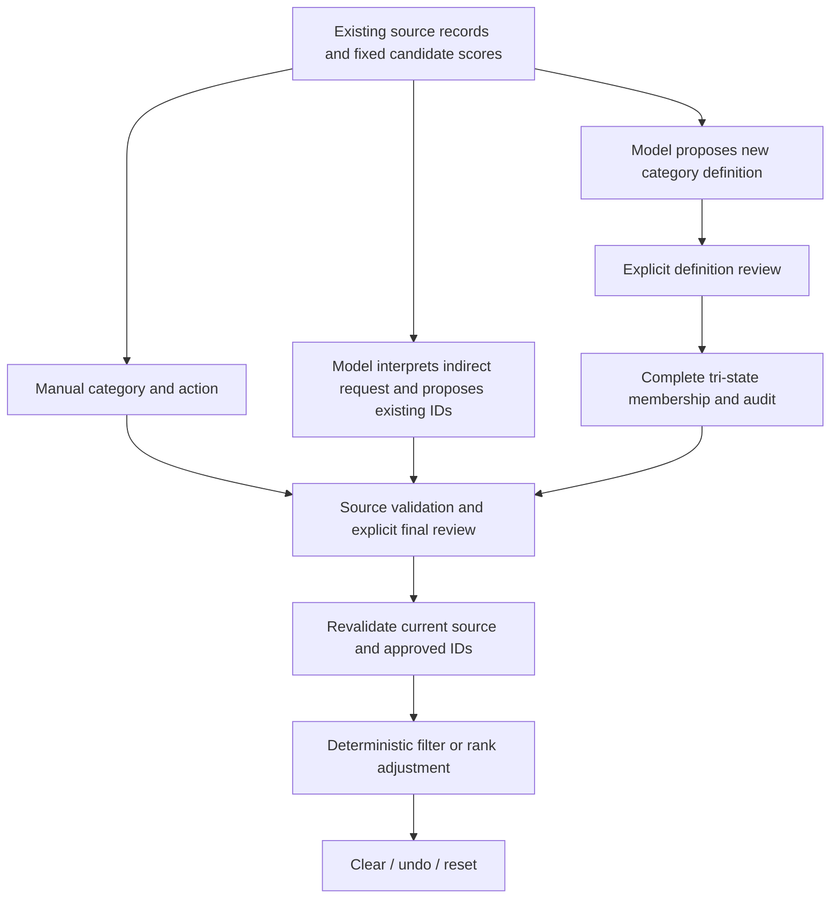

# Walkthrough: three control tracks and state safety

## Open the code in this order

| Stage | Source / symbols | Explain |
| --- | --- | --- |
| Existing data and candidate scores | `feedctrl/api.py`: `DemoState`, `rank`, `create_app` | Observed metadata and a saved scorer are distinct from clearly labelled synthetic fixtures and diagnostic vectors. Original A-E routes keep their original semantics. |
| Manual baseline | `feedctrl/semantic_review.py`: `/api/semantic/preview`, manual_category path | Select a supplied existing category and explicit action without inference; use the same reviewed explicit-item-set enforcement. |
| Nonliteral action and membership | `feedctrl/semantic_review.py`, `feedctrl/indirect_grounding.py` | Interpret one action, preserve the actual request span, propose existing IDs with source quotes, validate and require review. Graded boost/reduce and exclude/none remain distinct. |
| Provider seam | `feedctrl/api.py`: `semantic_infer_factory`; `feedctrl/model_adapters.py`: `HostedRunBudget`, `make_openai_responses_infer` | Operator supplies an adapter and honest provenance. A shared in-process call cap survives factory instances; it is not a durable dollar ceiling. |
| Category induction | `feedctrl/staged_routes.py`, `feedctrl/semantic_induction.py`, `feedctrl/category_induction_producer.py` | Separately review an evidence-grounded definition, classify every supplied record as match/not_match/unknown, audit, then review membership before application. |
| Approval and ranking | `feedctrl/semantic_review.py`: sealed groups, apply, history | Revalidate current source, IDs, inventory and action. Apply only the approved existing IDs; never broaden a reviewed set through literal aliases. |
| Fictional metadata | `feedctrl/synthetic_drafts.py`, `web/src/SyntheticDraftPanel.jsx` | Generated origin is permanent, explicit approval is required, and new records enter only an isolated diagnostic zero-score feed. |
| Reset | `feedctrl/api.py`: `/api/reset` | Clear active semantic groups, pending plans and history; preserve source records/categories and restore baseline eligibility. Revision counters can advance. |

## Short demonstration script

1. Show the data/scorer provenance and A-E comparison. Explain that fixture
   counts and diagnostic scores are synthetic, not measured relevance.
2. Select an existing category manually, review/apply exclusion, show the
   before/after eligible pool, then restore baseline. No model is needed.
3. Show the retained cross-cutting-category example and its separate definition
   and membership approvals. Explain that its label was absent from the registry
   and its membership crossed existing source categories.
4. Show the nonliteral wall-socket request. For a replay, label it **retained
   model replies; zero new generation**, never live inference. In the actual
   historical run, exact Copy text from two fresh browser chats entered the
   configured-provider route and explicit review preceded application.
5. Inspect all selected source quotes and the five omitted records. Unknown
   power supply is not a negative fact and must remain eligible.
6. Apply the exact exclusion, show five eligible records, clear to eight, undo
   clear to five, and undo the original apply to eight. Demonstrate active-group
   reset separately and identify whether evidence is API or browser execution.
7. Show fictional metadata preview and its permanent generated-origin and
   diagnostic score labels. Explain that no real media is fabricated.
8. Finish with the negative studies, capture failure, timeout and remaining
   limitations. Do not imply that a successful development example reverses a
   sealed benchmark result.

## Reproduction and transport boundary

Ordinary app startup is documented in `docs/app.md`; it does not automatically
connect a Claude browser subscription to the backend. A configured provider
requires an operator-supplied `semantic_infer_factory`. The development observer
and exact request/reply/state receipts are in the private sealed evidence ZIP.
The external observer is not a production authentication or browser automation
service. Do not start new inference from its exhausted two-message run.

The new active-reset check reuses only exact retained payload/schema pairs in a
fresh application session. It makes no network inference call and reports replay
separately from actual model execution. Old evidence is never rewritten.

From a new empty output directory, run `python <repo>/deliverables/2026-11-05-final-demo/verify_active_reset.py` using the project's installed test dependencies. It writes a new `ACTIVE-GROUP-RESET.json` with exclusive creation; it refuses to overwrite an existing receipt. The included `replay-inputs/` contain synthetic task records and the exact two retained application payload/schema/reply pairs, not credentials or model weights. The script checks that application source remains identical to base 71234a1 and then exercises preview, approval, active reset and stale-plan rejection through FastAPI TestClient.
