# 1. What it is

Feed Control Lab is the research application of the COMP 9500 project *LLM-Mediated Natural Language Controls for Short-Video Recommender Systems*.
It runs on your laptop and shows the real KuaiRec data (865 users, 2,593 items), ranked by the trained SASRec recommender (seed 42).
The view **Original study (A to E)** holds the five conditions of the original proposal. The view **Language controls** lets you change a user's feed in plain English.
In every language control a model only *proposes*. The server checks the proposal, you review it, **Apply** changes exactly what you reviewed, and **Undo** restores the previous feed.
The view **Results** shows the measured results of the offline evaluation, read from the result files.

Everything is in English. The KuaiRec text (titles, captions, cover text, topic tags and the three levels of category names) was translated into English *before* processing; the application, the models and the screen work on that English text only. It is a machine translation of KuaiRec (CC BY-SA 4.0), stored as a versioned file with its SHA-256 (`data/kuairec_text_en-v1.json`).

A demonstration video, `COMP9500-Feed-Control-Lab-demo.mp4`, is sent separately (not in the repository); the version sent with this guide was recorded on this English application and shows every workflow with OpenAI gpt-5, including where to paste your API key.

# 2. Install (once)

You need:

- **Python 3.12** (3.11 also works).
- **Node.js 22** only if the folder `web/dist` is missing (the built page is normally included). The test runner also uses Node for the browser checks.
- **Google Chrome** for the browser checks of `run-all-tests.cmd` (not for normal use; any browser opens the page).
- The **KuaiRec assets**: the processed data, the English text layer and the trained checkpoints. They are not in the git tree; they are published as GitHub Release assets under CC BY-SA 4.0 (attribution in `notices/KUAIREC-ASSETS-ATTRIBUTION.md`). One command downloads them and checks every SHA-256:

```
fetch-assets.cmd          (Windows)
./fetch-assets.sh         (macOS / Linux)
```

It needs only Python (no virtual environment yet) and writes these files:

| File or folder | What it is |
| --- | --- |
| `data/processed.json` | The processed KuaiRec subset (865 users, 2,593 items) |
| `data/kuairec_text_en-v1.json` | The English text layer the application loads: machine translation of KuaiRec (CC BY-SA 4.0) |
| `results/models/seed_42/`, `seed_43/`, `seed_44/` | The trained SASRec checkpoints (the app uses seed 42) |
| `data/raw/`, `data/kuairec_gloss_en.json`, `data/kuairec_text_en-v1.label-map.json` | The unchanged official source table (kept for the licence and for re-scoring the 17 November evaluation), the translation input and the map from each original label to its English label (for the English re-run of the evaluation). The application never loads them. |

If a file is already there with a different hash, it is reported and left alone (`--force` replaces it).

Open a terminal in the source folder (the folder that holds `pyproject.toml`) and run:

**Windows (Command Prompt or PowerShell)**

```
py -3.12 -m venv .venv
.venv\Scripts\python.exe -m pip install -e ".[test,recommender,providers]"
```

**macOS (Terminal)**

```
python3.12 -m venv .venv
.venv/bin/python -m pip install -e ".[test,recommender,providers]"
```

`recommender` installs PyTorch for the trained ranker; `providers` installs the OpenAI and Anthropic client libraries.

Only if `web/dist/index.html` is missing, build the page once:

```
cd web
npm ci
npm run build
cd ..
```

# 3. Start the application

**Windows:** double-click `run-app.cmd`, or run it in a terminal from the source folder:

```
run-app.cmd
```

**macOS:**

```
.venv/bin/python scripts/run_app.py
```

The terminal prints a short status (users, items, ranker, provider, and the English text layer with its SHA-256) and then `Open http://127.0.0.1:8765`. Open that address in a browser. Press **Ctrl+C** in the terminal to stop the server.

Useful options (the same on both systems; on Windows add them after `run-app.cmd`):

| Option | Effect |
| --- | --- |
| `--port 8770` | Use another port |
| `--provider openai --model gpt-5-mini` | Start with OpenAI already selected (the key comes from `OPENAI_API_KEY`) |
| `--budget-usd 1.00` | Stop model calls once this much has been spent in this server session. Each call reserves its upper-bound cost before it starts, so parallel calls cannot pass the limit together |

The server listens on `127.0.0.1` only, so nothing is reachable from other computers. Applied controls last until the server stops or you press **Reset this user**.

# 4. Choose a model and paste a key

Open **Language controls**. The bar at the top chooses the model provider for all language controls.

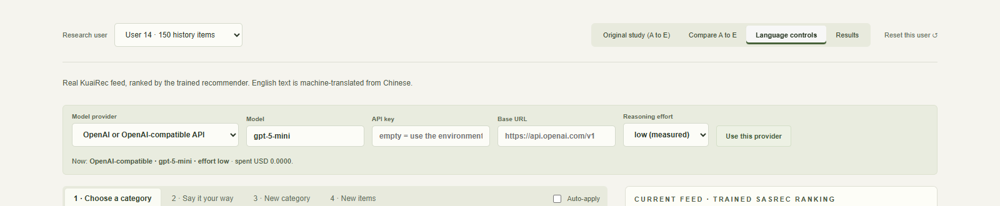

1. **Model provider:** choose *OpenAI or OpenAI-compatible API*.
2. **Model:** `gpt-5-mini` (recommended: fast and inexpensive). `gpt-5` also works; it is slower and about five times the price.
3. **Reasoning effort:** `low` is what the measured results used; `minimal` (OpenAI only) is much faster with gpt-5.
4. **API key:** paste your key. The field is masked. Leave **Base URL** as it is (`https://api.openai.com/v1`).
5. Press **Use this provider**. The line below the bar then says `Now: OpenAI-compatible · gpt-5-mini · effort low` together with the money spent so far.

The key is kept in the memory of the server process only. It is never written to a file or a log, and it is gone when you stop the server.

**Alternative: an environment variable.** Set `OPENAI_API_KEY` before you start the server and leave the key field empty. The page then shows `empty = use the environment variable`.

```
Windows:  set OPENAI_API_KEY=...        (Command Prompt)
          $env:OPENAI_API_KEY = "..."   (PowerShell)
macOS:    export OPENAI_API_KEY=...
```

**Other providers.**

- **Mock (no AI, for tests)** needs no key and costs nothing. It only matches literal words, so it cannot read indirect requests. Use it to look at the screens and for the test runner.
- **Ollama (local model on this computer)** needs no key. Start Ollama yourself with a large context window (`OLLAMA_CONTEXT_LENGTH=32768`) and pull a model, for example `qwen2.5-coder:7b-instruct`. Local models are slower. On the 17 November run (original text) llama3.1:8b and qwen2.5-coder:7b proposed almost nothing; the English-input re-run is pending.
- **Anthropic API:** a route exists (key from `ANTHROPIC_API_KEY`), but it has not been tested with a live key. Claude was measured only through the Claude command-line program.

With gpt-5-mini, an interpretation costs a fraction of a US cent, and a new category on 20 items about one cent. Every review shows the calls, seconds, tokens and the estimated cost.

# 5. The workflows

The screenshots below are from the real application on the English KuaiRec text, research user 14, with OpenAI gpt-5-mini (the manual control and conditions A to E call no model). All of them together cost USD 0.023, and each was checked for visible Chinese characters (none).

## 5.1 Original study (A to E)

The tab **Original study (A to E)** holds the five conditions of the original proposal: item feedback (A), explanations (B), a free-text category instruction (C), an editable profile (D) and all channels (E). Choose **C · Free text**, type `Show me more category_5` and press **Apply instruction**. The rule parser reads one category ID of the form `category_N`, and a fixed policy re-ranks the list. The language model does not rank items.

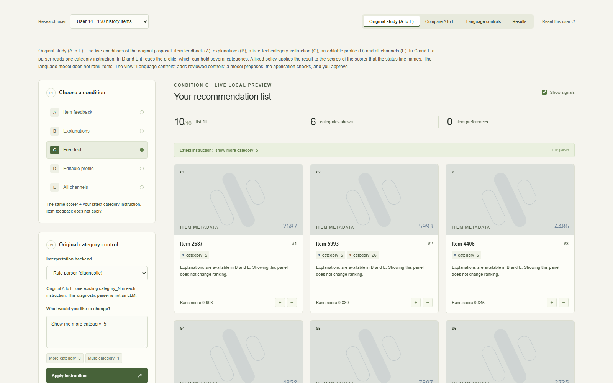

The tab **Compare A to E** shows the first ten items of each condition for the same user and the same inputs. It is a preview of the current inputs, not an experimental result.

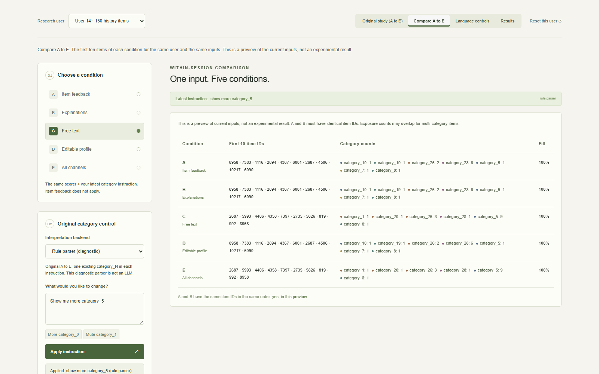

## 5.2 Language controls: the common pattern

Open **Language controls**. The left side has four tabs: **1 · Choose a category**, **2 · Say it your way**, **3 · New category** and **4 · New items**. The right side always shows the feed: the top ten of the chosen research user, ranked by the trained SASRec model.

Every workflow ends in a **Review** with three blocks:

1. **What came back** — the proposal, with the model's reason and the labels it chose.
2. **What the application checked** — each check with a tick or a cross, and the model calls with time and cost.
3. **Your decision** — the number of eligible items before and after, and **Apply** / **Discard**.

While a review is open, the feed is labelled **PREVIEW · NOT APPLIED**, and the **Before / After** switch above the feed compares the two lists. Nothing changes until you press **Apply**.

## 5.3 Manual control (Choose a category)

The reference control. No model is called.

1. Tab **1 · Choose a category**. Label type: **KuaiRec category**.
2. Type `Dance` into the filter and select **Dance · 104 items**.
3. Action: **Show more**, Strength: **strong**. Press **Preview**.

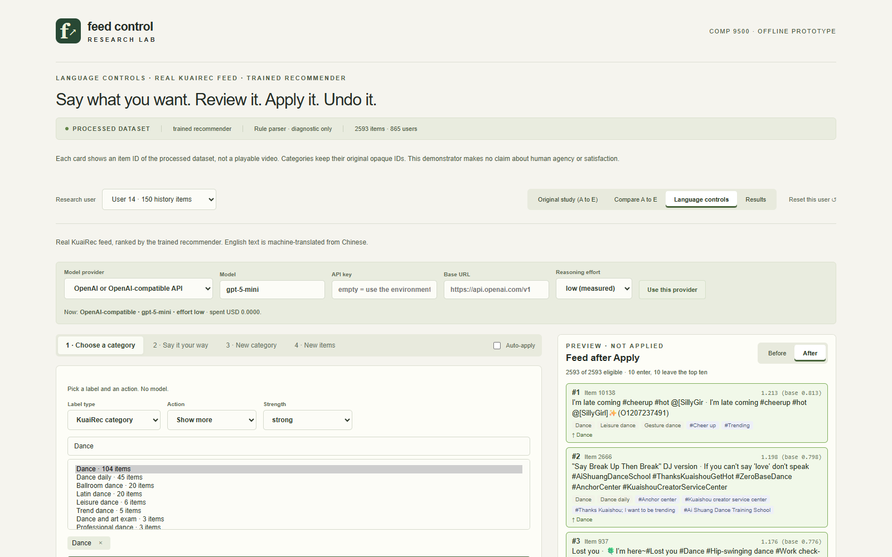

Press **Before** above the feed to see the list without the change:

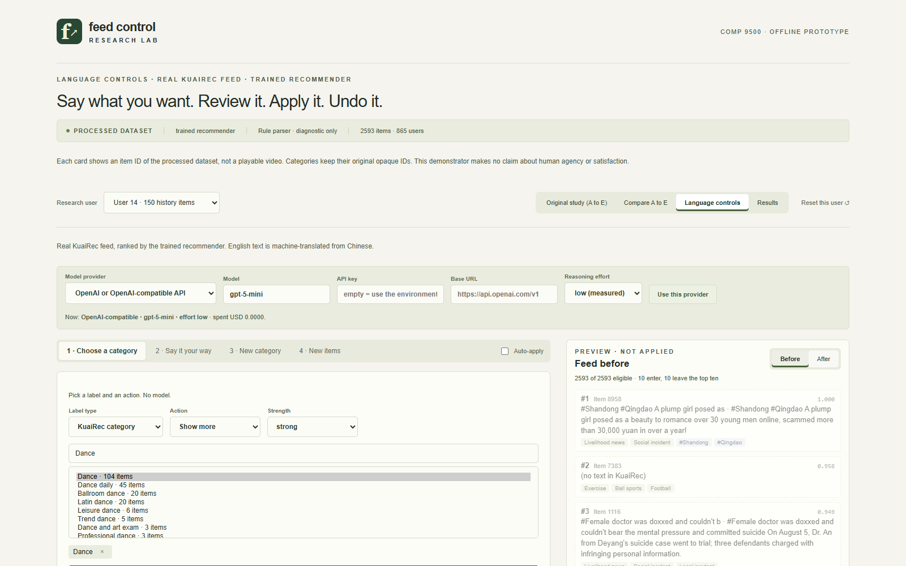

Press **Apply**. The control appears under **Applied now**. **Undo the last change** removes it again.

**Several labels at once.** Each label you click in the list is added to the picked labels shown under the list; the × next to a picked label removes it. Preview then applies the chosen action and strength to all picked labels in one preview, Apply applies them together, and one **Undo the last change** removes them all. The picked labels are cleared after Apply.

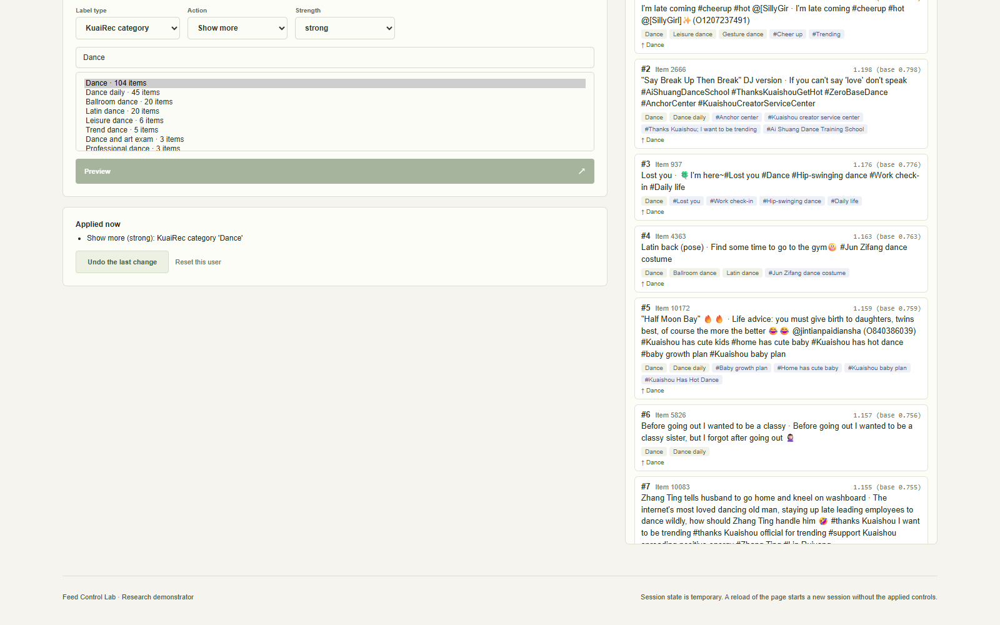

## 5.4 A request in your own words (Say it your way)

Tab **2 · Say it your way**. Write what you want in English; you do not need a category name. The model may only choose existing KuaiRec category names and topic tags, and the server checks that each one exists and that the quoted part of your request really occurs in it. Press **Interpret and preview**.

Example: `I just ate dinner, so stop tempting me with snacks and cooking clips.`

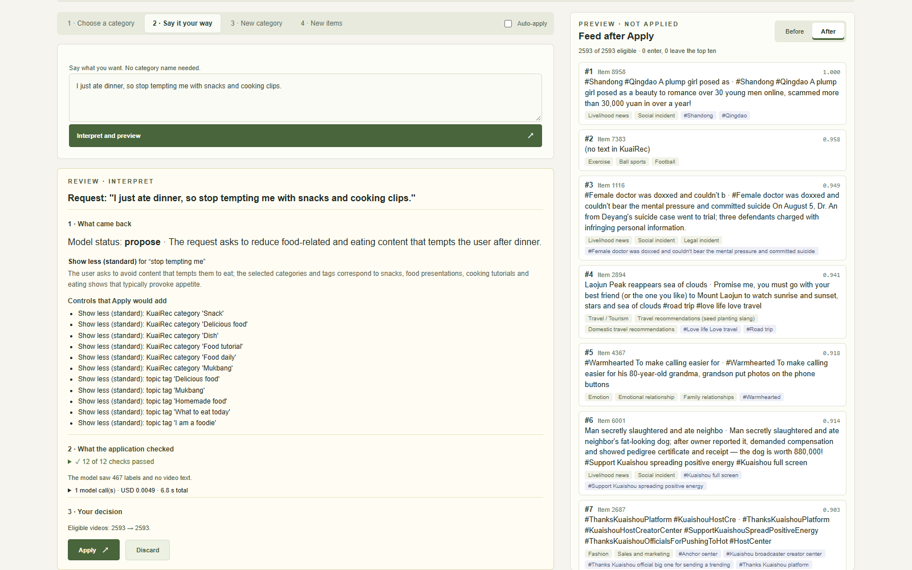

Second example: `There has been too much negative news lately; give me a few quiet days.`

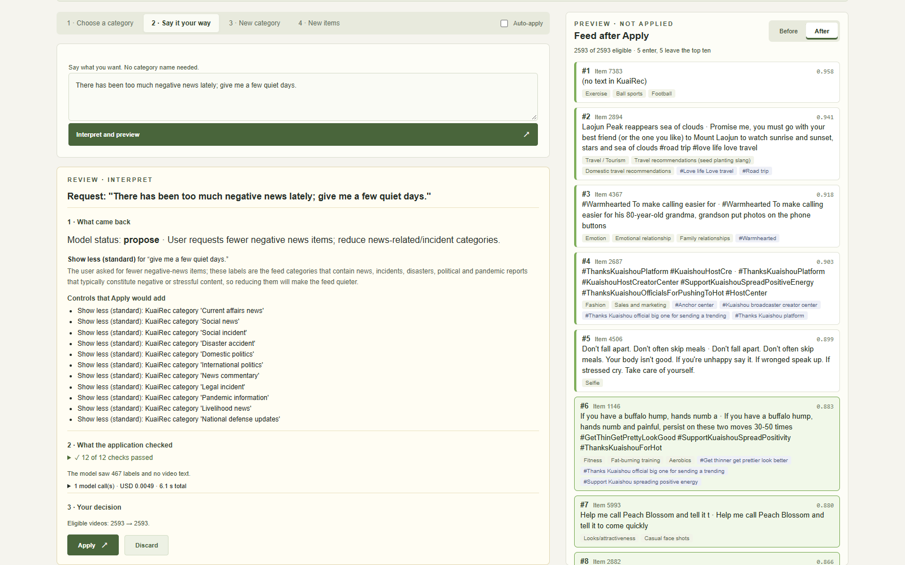

Read the three blocks, then **Apply** or **Discard**. Other examples to try: `Fewer celebrity entertainment videos, please.`, `Show me more basketball.`, `My cat is at the vet and I cannot bear to see animals right now.`, `I am training for a marathon and could use some motivation.`

## 5.5 A new category

Tab **3 · New category**. Describe a category that KuaiRec does not have, for example `Videos filmed outdoors in nature: mountains, rivers, fields or the sea.` Choose the scope (this user's top 10, 20, 40, 80, 120 or 200 items; 40 by default; 20 is enough for a demonstration) and press **Propose a definition**.

**Step 1 — review the definition.** The model proposes a label and a precise definition, with quotations from the user's top items that the server has found in the item text (ticks). If none of the sampled items fits the description, the model still proposes a definition from the description alone. You may edit the label and the definition. Choose what Apply should do (**Show only**, **Show more**, **Show less**, **Hide**).

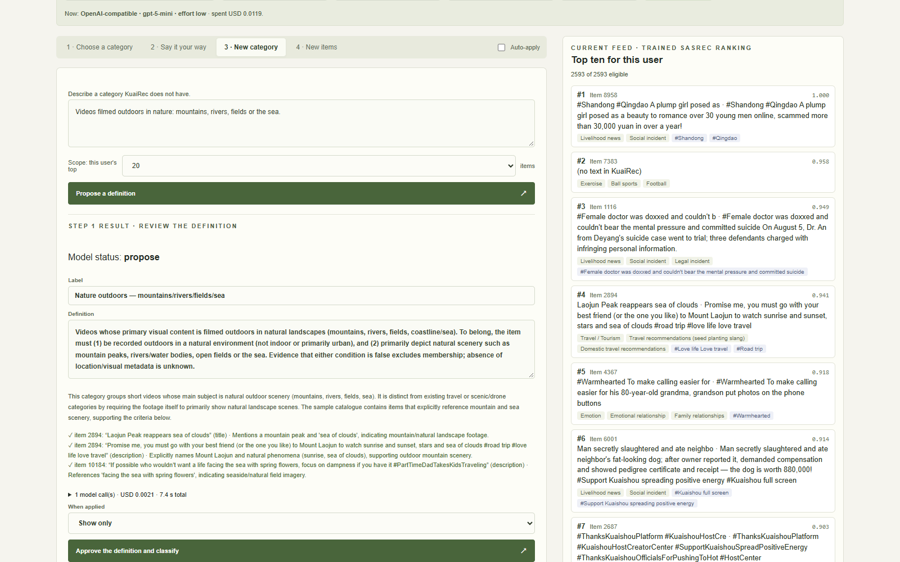

**Step 2 — classification and evidence.** Press **Approve the definition and classify**. The model classifies every item in the scope and must quote the exact words it relies on; a separate call checks each quotation cited for a match, without seeing the verdict. A quotation counts only if it has at least three characters and occurs in the named field (a tag must match a whole tag). Only items whose quotation exists *and* passed the check are selected. The table shows, for each item: the English KuaiRec text, the verdict, the quotation (found or not), the evidence check and whether it is selected.

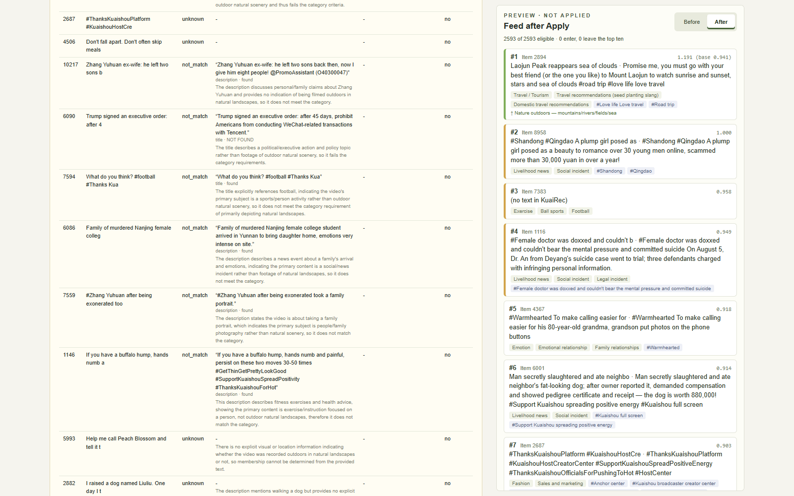

Press **Apply** to use the new category on the feed (here: *Show more*). A second example: `Videos that teach someone a practical skill step by step.`

## 5.6 New items

Tab **4 · New items**. Add items that are not in KuaiRec: a title and a description (up to ten items). Example: title `Weekend hike up the mountain`, description `A steep forest trail and a view over the city from the summit.` Press **Classify and preview**. The model assigns existing KuaiRec categories and tags; the server drops any label that does not exist. If you created a new category before, each new item is also judged against it with a quotation. New items have no viewing history, so they start at this user's median score.

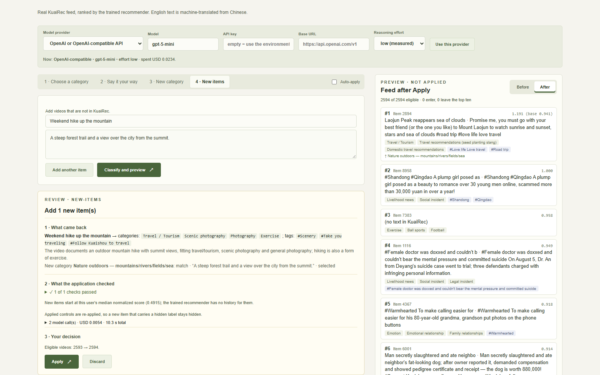

After **Apply** the item is listed under **Applied now** as an added item (ID 9000001) and takes part in the ranking; **Undo** removes it.

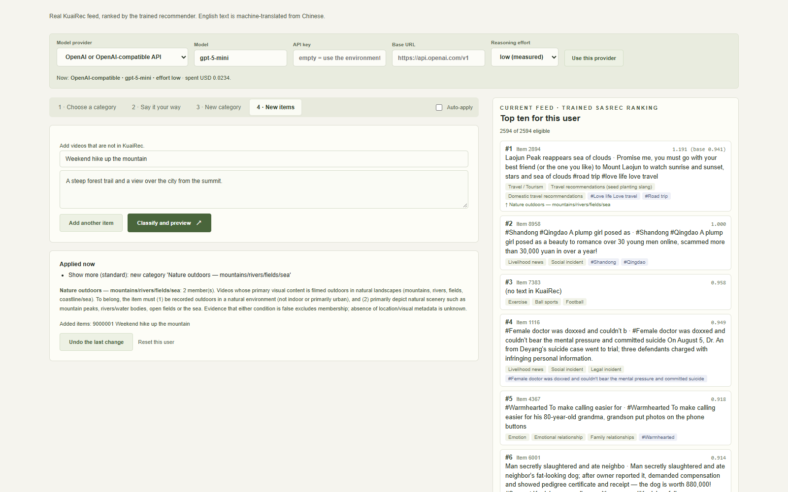

## 5.7 Auto-apply, Undo and Reset

- **Auto-apply** (the checkbox at the right of the tabs) applies each preview as soon as it arrives. The review is still shown, and **Undo** still works. Leave it off when you want to inspect each proposal first.
- **Undo the last change** restores the feed exactly as it was before the last Apply, one step at a time.
- **Reset this user** removes every control, new category and added item of this user and returns to the trained ranking.

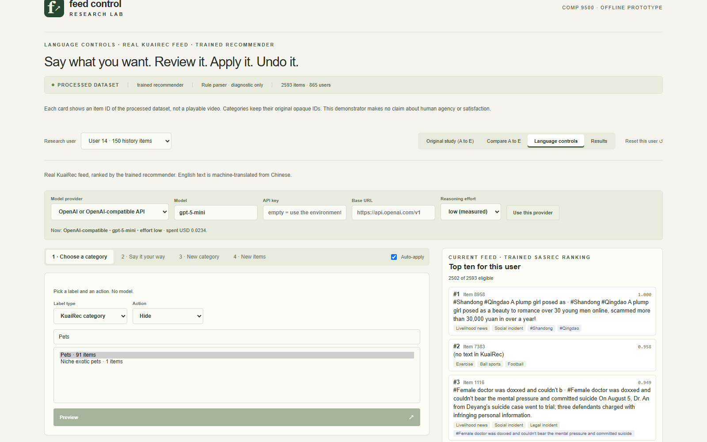

# 6. The Results page

The tab **Results** shows the measured results of the offline evaluation of the language controls. It reads the file `summary.json` of each run folder under `docs/evidence/lab-eval/<run>/` and shows each table with its run, test set and models.

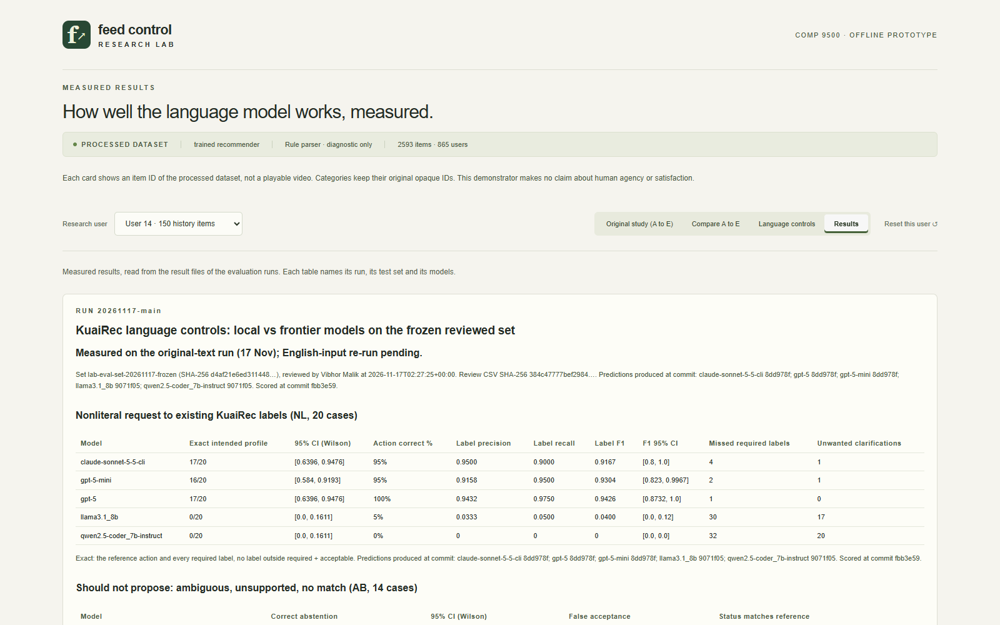

**Every number on this page was measured on the original-text run (17 Nov); the English-input re-run is pending.** The page says so above each run. The run `20261117-main` measured gpt-5, gpt-5-mini and Claude Sonnet 5.5 on a frozen set of 40 cases that Claude (Opus 5.5) drafted and Vibhor Malik reviewed row by row (1,211 rows, 24 corrections). Claude is therefore both the drafter's family and a measured model. Two local models, llama3.1:8b and qwen2.5-coder:7b-instruct through Ollama, ran the same 40 cases; on this laptop they proposed almost nothing (0 of 20 exact on the nonliteral requests) and took about two minutes per call. Each table names the commits that produced the predictions (hosted `8dd978f`, local `9071f05`) and the scoring commit (`fbb3e59`). The downstream tables apply each model's exact controls with the application's own policy.

# 7. Run all tests

**Windows:**

```
run-all-tests.cmd
```

**macOS:**

```
.venv/bin/python scripts/run_all_tests.py
```

It runs, in order:

1. the Python tests (`pytest` on `tests/`; the root-level `test_*.py` files and the `tools/hosted_validation*` tests are outside the runner);
2. the Node unit tests of the page (`web/tests/*.test.mjs`);
3. the application on real KuaiRec in a child process on a free port;
4. the browser flows in Chrome through Playwright (`tests/browser/lab_flows.cjs`): A to E, manual preview / Apply / Undo, the requests in your own words, a new category, a new item, auto-apply, reset and the Results page;
5. the English-only check (`tests/browser/cjk_check.cjs`): it walks every screen and every step of the recorded demo and fails on any visible Chinese, Japanese or full-width character (U+3000–U+303F, U+3400–U+9FFF, U+FF00–U+FFEF);
6. every workflow through the HTTP API on the examples of `tools/demo_examples.json`, with the latency and cost of every model call.

The receipts go to a new folder `runs/all-tests-<UTC time>/`: `summary.md` (readable), `summary.json`, `workflows.json`, `model-calls.json`, the logs of each step, the browser screenshots with `lab-browser-receipt.json` and `cjk/cjk-check-receipt.json`.

By default the runner uses the **mock** provider: no key, no cost, no network. The mock cannot read indirect requests, so those cases report that nothing matched; that is expected. To exercise a real model:

```
run-all-tests.cmd --provider openai --model gpt-5-mini
```

One Python test is reported separately as *frozen by design* (a frozen 11 November profile whose offline guard blocks a Windows library); it is listed in `summary.md` and does not hide any other failure. On first use the Windows runner installs Playwright into `node_modules` and the page's packages into `web/node_modules`, which needs Node and an internet connection.

# 8. Troubleshooting

| What you see | What to do |
| --- | --- |
| `address already in use` / the server stops at once | Another program (or an earlier server) uses port 8765. Close it, or start with `--port 8770` and open `http://127.0.0.1:8770`. |
| `Missing data files (they are not in the repository)` followed by a list | Run `fetch-assets.cmd` (section 2). |
| `First install: py -3.12 -m venv .venv ...` | The virtual environment does not exist yet. Run the install commands of section 2. |
| `The Python package for ... is not installed` | Install with the `providers` extra: `pip install -e ".[test,recommender,providers]"`. |
| A red message under the tabs, or `error: ...` in the model-call table of a review | The model call failed (wrong or missing key, no credit, network, unknown model name). The text is the provider's message. Nothing was applied. Fix the cause and press the button again. |
| Ollama: `The local model server cut the prompt at its context limit` | Stop Ollama and start it again with the environment variable `OLLAMA_CONTEXT_LENGTH=32768` (Windows: `set OLLAMA_CONTEXT_LENGTH=32768` then `ollama serve`; macOS: `OLLAMA_CONTEXT_LENGTH=32768 ollama serve`). |
| `Budget reached: USD ... No further model calls are made.` | The server was started with `--budget-usd` and the limit is spent. Restart the server with a higher limit. The provider bar always shows the amount spent. |
| A new category takes a minute or more | Classification sends ten items per call and checks each quotation separately. Use a smaller scope (20). |
| The page is blank or `web/dist` is missing | Build the page: `cd web`, `npm ci`, `npm run build`. |

# 9. What the application does not claim

The study is offline on KuaiRec with no user study. The English text is a machine translation: a wrong translation can make a label or a quotation misleading, and the measured numbers so far come from the run on the original text. The test set was drafted by an AI (Claude Opus 5.5) and reviewed row by row by a person, and a Claude model is also one of the measured models, which can favour Claude. The **Results** page states what was measured and its limits.
